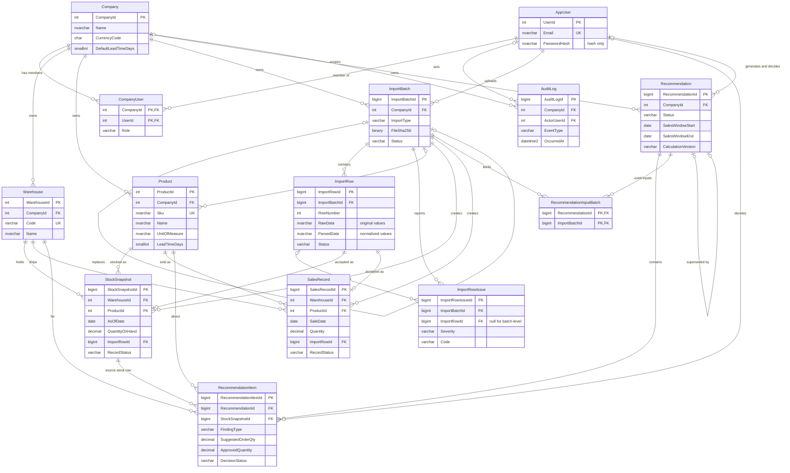
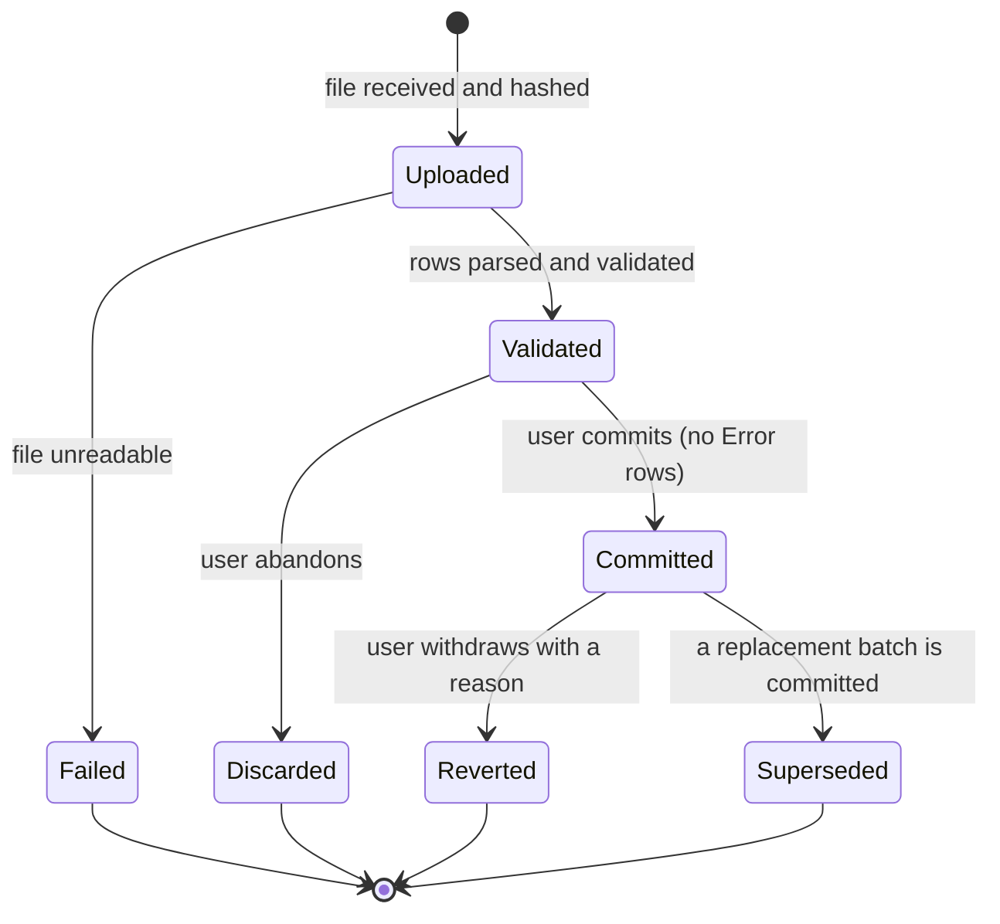
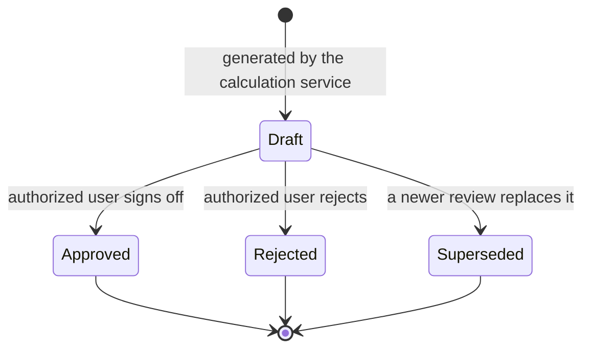

# WASEL database design (MVP)

| | |
|---|---|
| Status | **Draft for Product Owner review.** Design only. |
| Date | 2026-11-23 |
| Planned stack | SQL Server (2019 or later, or Azure SQL) with Entity Framework Core 8 |
| Related documents | [PRODUCT_BRIEF.md](PRODUCT_BRIEF.md), [ARCHITECTURE.md](ARCHITECTURE.md), [CLAUDE.md](../CLAUDE.md) |

> Nothing in this document has been implemented. No tables, migrations, EF Core packages, authentication, import code or AI code exist in the repository. The SQL fragments in this document are illustrative. They have not been executed against SQL Server; all but the `DENY` statement were syntax-checked with a T-SQL parser. Implementation waits for review and approval.

## Contents

1. [Scope and design principles](#1-scope-and-design-principles)
2. [Entity assessment](#2-entity-assessment)
3. [Entity relationship diagram](#3-entity-relationship-diagram)
4. [Relationships and cardinalities](#4-relationships-and-cardinalities)
5. [Table definitions](#5-table-definitions)
6. [Constraints and indexes](#6-constraints-and-indexes)
7. [Multi-tenant data isolation](#7-multi-tenant-data-isolation)
8. [Import workflow](#8-import-workflow)
9. [Stock snapshots and sales history](#9-stock-snapshots-and-sales-history)
10. [Recommendations: traceability and approval](#10-recommendations-traceability-and-approval)
11. [Audit logging](#11-audit-logging)
12. [CSV formats for the initial imports](#12-csv-formats-for-the-initial-imports)
13. [Business rules and assumptions](#13-business-rules-and-assumptions)
14. [EF Core mapping notes](#14-ef-core-mapping-notes)
15. [Open questions for the Product Owner](#15-open-questions-for-the-product-owner)
16. [Deferred items and extension path](#16-deferred-items-and-extension-path)

## 1. Scope and design principles

### 1.1 What this design covers

The persistence model for the MVP workflow in the product brief:

1. Import a simple CSV/Excel stock export and sales export.
2. Validate the data and show a preview.
3. Show stock health, fast/slow movers and potential stockout risks.
4. Explain each alert with transparent calculations and source rows.
5. Export a suggested replenishment review for a human to approve.

### 1.2 What it does not cover

Authentication and authorization implementation, the import pipeline code, the calculation service, the AI explanation service, accounting, payroll, route optimization, payments, automatic purchase orders and ERP replacement. The design must not make any of these harder to add later, but it does not include them.

### 1.3 Principles

| # | Principle | Consequence in this design |
|---|---|---|
| P1 | Source data is separate from calculated results. | `StockSnapshot` and `SalesRecord` are append-only. Calculated tables point to source tables; source tables never point to calculated tables. |
| P2 | AI never invents or silently changes quantities. | Quantity columns are written only by the deterministic calculation service. AI output is stored only in dedicated explanation columns and never read back into any calculation. |
| P3 | Every recommendation is traceable. | Each item stores the source stock row, the sales window, the aggregates it used, the parameters and the calculation version. The exact set of input import batches is recorded. |
| P4 | Purchasing decisions need human approval. | Suggested and approved quantities are separate columns. There is no purchase order table in the MVP. |
| P5 | Each company sees only its own data. | `CompanyId` on every tenant table, tenant-safe composite foreign keys, EF Core global query filters (section 7). |
| P6 | MVP-sized. | 14 tables. Anything that is not needed for the five workflow steps is deferred (section 16). |
| P7 | Missing is not zero. | A product absent from a stock file is "not reported", never zero stock. Blank mandatory values are errors, not defaults. |

## 2. Entity assessment

### 2.1 The proposed entities

| Proposed entity | Decision | Reasoning |
|---|---|---|
| Company | **Keep** | The tenant. Holds currency, time zone and default lead time. |
| User | **Keep, rename to `AppUser`** | `USER` is a reserved word in T-SQL and forces bracket quoting everywhere. `AppUser` is a global table (not tenant-scoped); the tenant is determined by `CompanyUser`. |
| CompanyUser | **Keep** | A role belongs to a user inside one company, and the same person may work with more than one company (for example an external accountant). If the Product Owner confirms one company per user, this collapses into two columns on `AppUser` (open question Q14). |
| Warehouse | **Keep** | Multiple warehouses per company are a requirement. |
| Product | **Keep** | Master data identified by company SKU. |
| Supplier | **Defer** | Neither the stock nor the sales import carries supplier data, and the MVP does not create purchase orders. What the calculation needs is a lead time, which can live on `Product.LeadTimeDays` with a company default. A free-text `Product.PreferredSupplierName` lets the review export group by supplier. A real `Supplier` table is added when suppliers need their own lead times, contacts or minimum order quantities (section 16). |
| ImportBatch | **Keep** | One uploaded file: who, when, file fingerprint, status. |
| ImportRow | **Keep** | The raw row as uploaded plus the normalized values the commit will use. This is the "source row" shown in explanations. |
| StockSnapshot | **Keep, as one flat row per warehouse, product and date** | A header/line split adds a join without a requirement for it: missing products are not treated as zero (P7), so "this snapshot is complete" is never needed. |
| SalesRecord | **Keep, as one flat row per sales line** | Replaces `SalesOrder` and `SalesOrderLine` from the architecture draft. Fast/slow-mover analysis needs date, product, warehouse and quantity; it does not need customers or order headers. |
| Recommendation | **Keep, defined as a replenishment review (header)** | One calculation run: its parameters, input batches, status and sign-off. |
| RecommendationItem | **Keep** | One finding per product and warehouse, with inputs, outputs, explanation and the human decision. |
| AuditLog | **Keep** | Required by the architecture for imports, recommendations and approvals. |

### 2.2 Added entities

| Entity | Why it is justified |
|---|---|
| `ImportRowIssue` | Requirement 6 asks for validation errors. A row can have several issues, and the preview needs counts by code ("12 rows with unknown SKU"). A child table is queryable and filterable; a JSON array on `ImportRow` is not. It also holds batch-level issues (missing header, overlapping period) with a null row. |
| `RecommendationInputBatch` | A recommendation can use several stock files (one per warehouse) and several sales files (one per month). The junction table records exactly which batches fed it, so the inputs can be rebuilt even if newer data is imported later. |

### 2.3 Entities in earlier documents that are not carried over

| Entity (source document) | Decision |
|---|---|
| StockMovement (ARCHITECTURE.md) | Deferred. The MVP receives periodic stock exports, not a movement ledger. Inferring movements from two snapshots would be a guess. |
| SalesOrder, SalesOrderLine (ARCHITECTURE.md) | Replaced by the flat `SalesRecord`. |
| PurchaseOrder (ARCHITECTURE.md) | Deferred. Automatic purchase orders are explicitly outside the first MVP. The approved quantity on `RecommendationItem` is the hand-off point. |
| Customer, Receivable (CLAUDE.md first-task list) | Deferred. They serve collections, not inventory risk. |

### 2.4 Layers

| Layer | Tables | Written by |
|---|---|---|
| Tenancy and identity | `Company`, `AppUser`, `CompanyUser` | Administration |
| Master data | `Warehouse`, `Product` | Setup, and the stock import for new products |
| Import pipeline | `ImportBatch`, `ImportRow`, `ImportRowIssue` | Import service |
| Source facts (append-only) | `StockSnapshot`, `SalesRecord` | Import commit only |
| Calculated results | `Recommendation`, `RecommendationInputBatch`, `RecommendationItem` | Calculation service; humans write only the decision columns |
| Audit | `AuditLog` | Application, in the same transaction as the change |

## 3. Entity relationship diagram

Every tenant table also carries `CompanyId` and a foreign key to `Company`. Only the main ones are drawn, to keep the diagram readable. Attribute types are simplified; exact types are in section 5.



## 4. Relationships and cardinalities

"Parent 1 : 0..*" means each parent can have zero or more children, and each child has exactly one parent unless the foreign key is nullable. No foreign key cascades deletes. Source and calculated data are not physically deleted in the MVP (rule BR-02).

| Parent | Child | Cardinality | Foreign key | Notes |
|---|---|---|---|---|
| Company | CompanyUser | 1 : 0..* | `CompanyUser.CompanyId` | Membership with a role. |
| AppUser | CompanyUser | 1 : 0..* | `CompanyUser.UserId` | A person can belong to several companies. |
| Company | Warehouse | 1 : 0..* | `Warehouse.CompanyId` | A company has one or more warehouses. |
| Company | Product | 1 : 0..* | `Product.CompanyId` | |
| Company | ImportBatch, Recommendation | 1 : 0..* | `CompanyId` | |
| Company | AuditLog | 0..1 : 0..* | `AuditLog.CompanyId` (nullable) | Null only for system-level events that have no company. |
| ImportBatch | ImportRow | 1 : 1..* | `ImportRow.ImportBatchId` | A parsed batch has at least one row. |
| ImportBatch | ImportRowIssue | 1 : 0..* | `ImportRowIssue.ImportBatchId` | |
| ImportRow | ImportRowIssue | 0..1 : 0..* | `ImportRowIssue.ImportRowId` (nullable) | Null means a batch-level issue. |
| ImportBatch | StockSnapshot, SalesRecord | 1 : 0..* | `ImportBatchId` | Records exist only after commit. |
| ImportRow | StockSnapshot, SalesRecord | 1 : 0..1 | `ImportRowId` (unique) | Every accepted record points to exactly one source row; a row yields at most one record. |
| ImportBatch | Product | 0..1 : 0..* | `Product.CreatedByImportBatchId` | The batch that first created the product. |
| ImportBatch | ImportBatch | 0..1 : 0..1 | `ReplacesImportBatchId` | A corrected file replacing an earlier one. |
| Warehouse | StockSnapshot, SalesRecord, RecommendationItem | 1 : 0..* | `WarehouseId` | |
| Product | StockSnapshot, SalesRecord, RecommendationItem | 1 : 0..* | `ProductId` | |
| Recommendation | RecommendationItem | 1 : 1..* | `RecommendationItem.RecommendationId` | A review with no findings has zero items and a count on the header. |
| Recommendation | ImportBatch | *: * | via `RecommendationInputBatch` | The input set. |
| StockSnapshot | RecommendationItem | 1 : 0..* | `RecommendationItem.StockSnapshotId` | The stock row an item was calculated from. |
| Recommendation | Recommendation | 0..1 : 0..1 | `SupersededByRecommendationId` | |
| AppUser | ImportBatch, Recommendation, RecommendationItem, AuditLog | 0..1 : 0..* | `...UserId` columns | Who uploaded, committed, generated, decided or acted. |

## 5. Table definitions

### 5.0 Conventions

| Topic | Convention |
|---|---|
| Names | PascalCase, singular table names, schema `dbo`. |
| Primary keys | `int IDENTITY` for small master tables; `bigint IDENTITY` for import, fact, calculated and audit tables. Identifiers are never trusted alone: every query is also scoped by `CompanyId` (section 7). |
| Quantities | `decimal(18,3)`: whole units, cartons or kilograms with grams. Never `float` or `real`. |
| Unit costs | `decimal(18,4)`. |
| Money totals | `decimal(18,2)`. `money` is not used. |
| Averages and ratios | `decimal(18,6)` for per-day rates, `decimal(10,2)` for days of cover. |
| Business dates | `date`, in the company's local calendar. |
| Timestamps | `datetime2(3)` in UTC. Egypt observes daylight saving time again, so local time is never stored. |
| Text for people | `nvarchar` (Arabic and English). Codes and enumerations are `varchar`. |
| Enumerations | `varchar` with a `CHECK` constraint, mapped to .NET enums as strings so the data stays readable. |
| JSON | `nvarchar(max)` with `CHECK (ISJSON(col) = 1)`. Used only for raw/normalized import values, parameters and calculation traces, never for columns that are filtered or aggregated. |
| Concurrency | `RowVersion rowversion` on tables that users or services update. |
| Deletion | No hard deletes. Master data uses `IsActive`; source data uses `RecordStatus`. |
| Alternate keys | Each tenant table that is referenced by another has `UNIQUE (CompanyId, <PK>)` so child tables can use tenant-safe composite foreign keys (section 7). |

Key notation below: **PK** primary key, **UQ** unique constraint or unique index, **FK → Table.Column** foreign key (composite with `CompanyId` for tenant tables), **CK** check constraint.

### 5.1 `Company`

| Column | Type | Null | Key / constraint | Notes |
|---|---|---|---|---|
| `CompanyId` | int IDENTITY | No | PK | |
| `Name` | nvarchar(200) | No | | |
| `CurrencyCode` | char(3) | No | CK upper-case letters; default `EGP` | One currency per company (BR-16). |
| `TimeZoneId` | varchar(64) | No | default `Africa/Cairo` | IANA identifier, used to turn business dates into UTC ranges. |
| `DefaultLeadTimeDays` | smallint | Yes | CK between 0 and 365 | Fallback when a product has no lead time. If both are null the item is `InsufficientData` (BR-06). |
| `IsActive` | bit | No | default 1 | |
| `CreatedAt` | datetime2(3) | No | | |
| `RowVersion` | rowversion | No | | |

### 5.2 `AppUser`

Global table, the only one without `CompanyId` besides `Company` itself.

| Column | Type | Null | Key / constraint | Notes |
|---|---|---|---|---|
| `UserId` | int IDENTITY | No | PK | If ASP.NET Core Identity is adopted this maps to its user table with a configured key type. |
| `Email` | nvarchar(256) | No | UQ (case-insensitive collation) | Login name. |
| `DisplayName` | nvarchar(150) | No | | |
| `PasswordHash` | nvarchar(512) | Yes | | **Hash only**, produced by a salted, slow, versioned algorithm (for example the ASP.NET Core Identity password hasher, which uses PBKDF2). Never plain text, never reversible encryption. Null if sign-in is delegated to an external identity provider. The choice is open (Q15). |
| `IsActive` | bit | No | default 1 | |
| `FailedLoginCount` | smallint | No | default 0 | Placeholder for lockout; final shape depends on the authentication design. |
| `LockoutEndAt` | datetime2(3) | Yes | | |
| `LastLoginAt` | datetime2(3) | Yes | | |
| `CreatedAt` | datetime2(3) | No | | |
| `RowVersion` | rowversion | No | | |

### 5.3 `CompanyUser`

| Column | Type | Null | Key / constraint | Notes |
|---|---|---|---|---|
| `CompanyId` | int | No | PK, FK → Company.CompanyId | |
| `UserId` | int | No | PK, FK → AppUser.UserId | |
| `Role` | varchar(30) | No | CK in (`Owner`, `OperationsManager`, `WarehouseManager`, `SalesSupervisor`) | The four roles in the product brief. `Owner` covers "Owner / General Manager". What each role may do is enforced in application code (section 7.4). |
| `IsActive` | bit | No | default 1 | |
| `CreatedAt` | datetime2(3) | No | | |

### 5.4 `Warehouse`

| Column | Type | Null | Key / constraint | Notes |
|---|---|---|---|---|
| `WarehouseId` | int IDENTITY | No | PK | |
| `CompanyId` | int | No | FK → Company.CompanyId; UQ (CompanyId, WarehouseId) | |
| `Code` | varchar(30) | No | UQ (CompanyId, Code) | The company's own code, used in CSV files. |
| `Name` | nvarchar(150) | No | | |
| `IsActive` | bit | No | default 1 | |
| `CreatedAt` | datetime2(3) | No | | |
| `RowVersion` | rowversion | No | | |

### 5.5 `Product`

| Column | Type | Null | Key / constraint | Notes |
|---|---|---|---|---|
| `ProductId` | int IDENTITY | No | PK | |
| `CompanyId` | int | No | FK → Company.CompanyId; UQ (CompanyId, ProductId) | |
| `Sku` | nvarchar(50) | No | UQ (CompanyId, Sku) | Always text, never numeric (leading zeros). Trimmed; compared case-insensitively. |
| `Name` | nvarchar(200) | No | | |
| `Barcode` | varchar(50) | Yes | | Informational. |
| `Category` | nvarchar(100) | Yes | | Plain text; no category table in the MVP. |
| `UnitOfMeasure` | nvarchar(30) | No | | The one unit all quantities for this product use (BR-12), for example "carton". |
| `LeadTimeDays` | smallint | Yes | CK between 0 and 365 | Days from order to receipt. |
| `PreferredSupplierName` | nvarchar(200) | Yes | | Free text, replaces the deferred `Supplier` table. |
| `IsActive` | bit | No | default 1 | |
| `CreatedByImportBatchId` | bigint | Yes | FK → ImportBatch.ImportBatchId | Which import first created the product. |
| `CreatedAt` | datetime2(3) | No | | |
| `UpdatedAt` | datetime2(3) | Yes | | |
| `RowVersion` | rowversion | No | | |

### 5.6 `ImportBatch`

| Column | Type | Null | Key / constraint | Notes |
|---|---|---|---|---|
| `ImportBatchId` | bigint IDENTITY | No | PK | |
| `CompanyId` | int | No | FK → Company.CompanyId; UQ (CompanyId, ImportBatchId) | |
| `ImportType` | varchar(10) | No | CK in (`Stock`, `Sales`) | |
| `SourceFormat` | varchar(10) | No | CK in (`CSV`, `XLSX`) | |
| `FileName` | nvarchar(260) | No | | As uploaded, for display only. |
| `FileSizeBytes` | bigint | No | | |
| `FileSha256` | binary(32) | No | UQ filtered, see section 6 | Fingerprint of the file bytes, used for duplicate detection. |
| `Status` | varchar(12) | No | CK in (`Uploaded`, `Validated`, `Committed`, `Discarded`, `Failed`, `Superseded`, `Reverted`) | Lifecycle in section 8. |
| `PeriodStart` | date | Yes | | Stock: the as-of date. Sales: first sale date in the file. |
| `PeriodEnd` | date | Yes | CK `PeriodStart <= PeriodEnd` | Stock: the as-of date. Sales: last sale date. |
| `TotalRows` | int | No | default 0 | |
| `ValidRows` | int | No | default 0 | |
| `WarningRows` | int | No | default 0 | |
| `ErrorRows` | int | No | default 0 | |
| `UploadedByUserId` | int | No | FK → AppUser.UserId | |
| `UploadedAt` | datetime2(3) | No | | |
| `CommittedByUserId` | int | Yes | FK → AppUser.UserId | |
| `CommittedAt` | datetime2(3) | Yes | CK both or neither of the two commit columns | |
| `RevertedByUserId` | int | Yes | FK → AppUser.UserId | |
| `RevertedAt` | datetime2(3) | Yes | | |
| `RevertReason` | nvarchar(500) | Yes | | Required when reverting or superseding (BR-18). |
| `ReplacesImportBatchId` | bigint | Yes | FK → ImportBatch.ImportBatchId | The earlier batch this one replaces. |
| `RowVersion` | rowversion | No | | |

### 5.7 `ImportRow`

One row per data row in the uploaded file, kept exactly as received.

| Column | Type | Null | Key / constraint | Notes |
|---|---|---|---|---|
| `ImportRowId` | bigint IDENTITY | No | PK | |
| `CompanyId` | int | No | FK → Company.CompanyId; UQ (CompanyId, ImportRowId) | |
| `ImportBatchId` | bigint | No | FK → ImportBatch.ImportBatchId; UQ (ImportBatchId, RowNumber) | |
| `RowNumber` | int | No | | 1-based data row number in the file (header excluded). |
| `RawData` | nvarchar(max) | No | CK `ISJSON = 1` | The original header-to-text values of the template columns, untouched. Columns outside the template are dropped at parse time (data minimization) and reported as an `Info` issue. |
| `ParsedData` | nvarchar(max) | Yes | CK `ISJSON = 1` | The typed, normalized values the commit will use (trimmed SKU, parsed decimals and dates). Null while `Pending` or when the row is unreadable. What the user previewed is what is committed. |
| `RowHash` | binary(32) | Yes | | SHA-256 of the normalized business fields, for duplicate detection inside the file. |
| `Status` | varchar(10) | No | CK in (`Pending`, `Valid`, `Warning`, `Error`) | Worst issue severity of the row. |

### 5.8 `ImportRowIssue`

| Column | Type | Null | Key / constraint | Notes |
|---|---|---|---|---|
| `ImportRowIssueId` | bigint IDENTITY | No | PK | |
| `CompanyId` | int | No | FK → Company.CompanyId | |
| `ImportBatchId` | bigint | No | FK → ImportBatch.ImportBatchId | |
| `ImportRowId` | bigint | Yes | FK → ImportRow.ImportRowId | Null for batch-level issues. |
| `Severity` | varchar(7) | No | CK in (`Error`, `Warning`, `Info`) | `Error` blocks commit; `Warning` needs acknowledgement; `Info` is informational. |
| `Code` | varchar(50) | No | | Stable machine code such as `SKU_UNKNOWN` (full list in section 12.4). The user interface localizes it. |
| `FieldName` | varchar(60) | Yes | | |
| `OriginalValue` | nvarchar(200) | Yes | | The offending value, truncated. |
| `Message` | nvarchar(500) | No | | Developer-readable English text. |
| `CreatedAt` | datetime2(3) | No | | |

### 5.9 `StockSnapshot`

Stock on hand for one product in one warehouse on one date, as reported by the customer. Append-only.

| Column | Type | Null | Key / constraint | Notes |
|---|---|---|---|---|
| `StockSnapshotId` | bigint IDENTITY | No | PK | |
| `CompanyId` | int | No | FK → Company.CompanyId; UQ (CompanyId, StockSnapshotId) | |
| `WarehouseId` | int | No | FK → Warehouse.WarehouseId | |
| `ProductId` | int | No | FK → Product.ProductId | |
| `AsOfDate` | date | No | | Daily granularity (A-02). |
| `QuantityOnHand` | decimal(18,3) | No | | As reported. Negative values are stored as given and raise a warning (BR-14). |
| `QuantityOnOrder` | decimal(18,3) | Yes | CK `>= 0` | Already ordered but not yet received, if the export has it. Null means "not provided". |
| `UnitCost` | decimal(18,4) | Yes | CK `>= 0` | Cost at that date, for stock value. Informational in the MVP. |
| `MinStockQty` | decimal(18,3) | Yes | CK `>= 0` | The customer's own minimum, if supplied. Source data, never overwritten by the system. |
| `ImportBatchId` | bigint | No | FK → ImportBatch.ImportBatchId | |
| `ImportRowId` | bigint | No | FK → ImportRow.ImportRowId; UQ | Not null: every record traces to a source row. Unique: a row cannot be committed twice. |
| `RecordStatus` | varchar(10) | No | CK in (`Active`, `Superseded`, `Reverted`); default `Active` | The only column that changes after insert (section 9.3). |
| `CreatedAt` | datetime2(3) | No | | |

### 5.10 `SalesRecord`

One sales line as reported by the customer. Append-only.

| Column | Type | Null | Key / constraint | Notes |
|---|---|---|---|---|
| `SalesRecordId` | bigint IDENTITY | No | PK | |
| `CompanyId` | int | No | FK → Company.CompanyId | |
| `WarehouseId` | int | No | FK → Warehouse.WarehouseId | The warehouse that fulfilled the line (Q2). |
| `ProductId` | int | No | FK → Product.ProductId | |
| `SaleDate` | date | No | | |
| `Quantity` | decimal(18,3) | No | CK `<> 0` | In the product's unit. Negative means a return (BR-13). |
| `NetAmount` | decimal(18,2) | Yes | | Line total after discounts, in the company currency. Informational in the MVP. |
| `DocumentNumber` | nvarchar(50) | Yes | | Invoice or credit note number, strongly recommended: it enables line-level duplicate detection. |
| `LineNumber` | int | Yes | CK `DocumentNumber IS NULL OR LineNumber IS NOT NULL` | |
| `ImportBatchId` | bigint | No | FK → ImportBatch.ImportBatchId | |
| `ImportRowId` | bigint | No | FK → ImportRow.ImportRowId; UQ | Same rule as `StockSnapshot`. |
| `RecordStatus` | varchar(10) | No | CK in (`Active`, `Superseded`, `Reverted`); default `Active` | |
| `CreatedAt` | datetime2(3) | No | | |

### 5.11 `Recommendation`

A replenishment review: one calculation run and its sign-off.

| Column | Type | Null | Key / constraint | Notes |
|---|---|---|---|---|
| `RecommendationId` | bigint IDENTITY | No | PK | |
| `CompanyId` | int | No | FK → Company.CompanyId; UQ (CompanyId, RecommendationId) | |
| `Status` | varchar(10) | No | CK in (`Draft`, `Approved`, `Rejected`, `Superseded`) | Lifecycle in section 10.2. |
| `StockAsOfDate` | date | No | | Latest stock date used. |
| `SalesWindowStart` | date | No | | |
| `SalesWindowEnd` | date | No | CK `SalesWindowStart <= SalesWindowEnd` | |
| `CalculationVersion` | varchar(20) | No | | Version of the deterministic algorithm, so old results can be explained after the rules change. |
| `ParametersJson` | nvarchar(max) | No | CK `ISJSON = 1` | Every parameter the calculation used (safety days, target cover, thresholds, defaults), copied at generation time. Changing company settings later never alters history. |
| `ProductsAnalyzed` | int | No | | Includes healthy products that produced no item. |
| `ItemsFlagged` | int | No | | Equals the number of items. |
| `GeneratedByUserId` | int | Yes | FK → AppUser.UserId | Null for a scheduled system run. |
| `GeneratedAt` | datetime2(3) | No | | |
| `DecidedByUserId` | int | Yes | FK → AppUser.UserId | The approver or rejecter of the whole review. |
| `DecidedAt` | datetime2(3) | Yes | | |
| `DecisionNote` | nvarchar(500) | Yes | | |
| `SupersededByRecommendationId` | bigint | Yes | FK → Recommendation.RecommendationId | |
| `RowVersion` | rowversion | No | | |

CK: when `Status` is `Approved` or `Rejected`, `DecidedByUserId` and `DecidedAt` are not null.

### 5.12 `RecommendationInputBatch`

| Column | Type | Null | Key / constraint | Notes |
|---|---|---|---|---|
| `CompanyId` | int | No | FK → Company.CompanyId | |
| `RecommendationId` | bigint | No | PK, FK → Recommendation.RecommendationId | |
| `ImportBatchId` | bigint | No | PK, FK → ImportBatch.ImportBatchId | The batch's type (`Stock` or `Sales`) tells which kind of input it was. |

### 5.13 `RecommendationItem`

One finding for one product in one warehouse. Input and output columns are written once at generation. Only the explanation and decision columns can change, and only while the review is `Draft`.

| Column | Type | Null | Key / constraint | Notes |
|---|---|---|---|---|
| `RecommendationItemId` | bigint IDENTITY | No | PK | |
| `CompanyId` | int | No | FK → Company.CompanyId | |
| `RecommendationId` | bigint | No | FK → Recommendation.RecommendationId; UQ (RecommendationId, WarehouseId, ProductId) | |
| `WarehouseId` | int | No | FK → Warehouse.WarehouseId | |
| `ProductId` | int | No | FK → Product.ProductId | |
| `FindingType` | varchar(20) | No | CK in (`StockoutRisk`, `Overstock`, `SlowMover`, `InsufficientData`) | |
| `StockSnapshotId` | bigint | No | FK → StockSnapshot.StockSnapshotId | The exact source stock row. |
| `QuantityOnHand` | decimal(18,3) | No | | Copied from the snapshot as used. |
| `QuantityOnOrder` | decimal(18,3) | Yes | | As used; null = not provided and treated as 0 (BR-03). |
| `SalesQtyInWindow` | decimal(18,3) | No | | Net quantity sold in the review's window. |
| `SalesRecordCount` | int | No | | Number of sales rows aggregated. |
| `AvgDailySales` | decimal(18,6) | Yes | | |
| `LeadTimeDays` | smallint | Yes | | As used. |
| `LeadTimeSource` | varchar(15) | Yes | CK in (`Product`, `CompanyDefault`) | |
| `DaysOfCover` | decimal(10,2) | Yes | | |
| `ReorderPointQty` | decimal(18,3) | Yes | | |
| `SuggestedOrderQty` | decimal(18,3) | Yes | CK `>= 0` | Produced by the calculation only. Null for findings that are not an order (for example `Overstock`) and for `InsufficientData`. |
| `ConfidenceLevel` | varchar(6) | Yes | CK in (`High`, `Medium`, `Low`) | Derived by deterministic rules (for example from sales coverage of the window), not by AI. |
| `LimitationsText` | nvarchar(500) | Yes | | Plain statement of what limits the result ("only 12 of 30 days have sales", "on-order not provided"). |
| `CalculationTraceJson` | nvarchar(max) | No | CK `ISJSON = 1` | Step-by-step values and formulas used, so the explanation screen can show the arithmetic. |
| `ExplanationText` | nvarchar(max) | Yes | | Human-readable explanation. Never an input to any calculation. |
| `ExplanationSource` | varchar(8) | Yes | CK in (`Template`, `AI`) | Marks AI-written text as such. |
| `ExplanationModel` | varchar(100) | Yes | | Model or template version, if `AI`. |
| `ExplanationGeneratedAt` | datetime2(3) | Yes | | |
| `DecisionStatus` | varchar(10) | No | CK in (`Pending`, `Accepted`, `Modified`, `Rejected`); default `Pending` | |
| `ApprovedQuantity` | decimal(18,3) | Yes | CK `>= 0` | The quantity a human approved. Always stored, even when equal to the suggestion. |
| `DecidedByUserId` | int | Yes | FK → AppUser.UserId | |
| `DecidedAt` | datetime2(3) | Yes | | |
| `DecisionNote` | nvarchar(500) | Yes | | Required when `Modified` (BR-08). |
| `RowVersion` | rowversion | No | | |

### 5.14 `AuditLog`

| Column | Type | Null | Key / constraint | Notes |
|---|---|---|---|---|
| `AuditLogId` | bigint IDENTITY | No | PK | |
| `CompanyId` | int | Yes | FK → Company.CompanyId | Null only for events outside any company. |
| `ActorType` | varchar(6) | No | CK in (`User`, `System`, `AI`) | |
| `ActorUserId` | int | Yes | FK → AppUser.UserId | Null when `ActorType` is not `User`. |
| `EventType` | varchar(60) | No | | For example `Import.Committed` (section 11.1). |
| `EntityType` | varchar(40) | Yes | | |
| `EntityId` | bigint | Yes | | Polymorphic reference with no foreign key, so the log survives any change to the referenced table. |
| `OccurredAt` | datetime2(3) | No | | UTC. |
| `CorrelationId` | uniqueidentifier | Yes | | Ties together the events of one request or job. |
| `DetailsJson` | nvarchar(max) | Yes | CK `ISJSON = 1` | Before/after values and parameters. Never secrets (section 11.3). |
| `IpAddress` | varchar(45) | Yes | | |

## 6. Constraints and indexes

### 6.1 Unique constraints

| Table | Unique on | Purpose |
|---|---|---|
| AppUser | `Email` | One account per email. |
| Warehouse | `(CompanyId, Code)` | CSV warehouse codes resolve to one warehouse. |
| Product | `(CompanyId, Sku)` | CSV SKUs resolve to one product. |
| ImportBatch | `(CompanyId, ImportType, FileSha256)` where `Status` is `Uploaded`, `Validated` or `Committed` | The same file cannot be active twice (section 8.4). |
| ImportRow | `(ImportBatchId, RowNumber)` | |
| StockSnapshot | `(CompanyId, WarehouseId, ProductId, AsOfDate)` where `RecordStatus = 'Active'` | One active stock level per product, warehouse and day. |
| StockSnapshot, SalesRecord | `ImportRowId` | A source row is committed at most once, which makes a retried commit harmless. |
| SalesRecord | `(CompanyId, WarehouseId, DocumentNumber, LineNumber)` where active and both are not null | Line-level duplicate guard. |
| RecommendationItem | `(RecommendationId, WarehouseId, ProductId)` | One finding per product and warehouse per review. |
| Alternate keys | `(CompanyId, <PK>)` on Warehouse, Product, ImportBatch, ImportRow, StockSnapshot, Recommendation | Targets for tenant-safe composite foreign keys. |

### 6.2 Check constraints

| Table | Rule |
|---|---|
| All enumerations | `CHECK (col IN (...))` as listed in section 5. |
| JSON columns | `CHECK (ISJSON(col) = 1)`. |
| SalesRecord | `Quantity <> 0`; `DocumentNumber IS NULL OR LineNumber IS NOT NULL`. |
| StockSnapshot | `QuantityOnOrder`, `UnitCost`, `MinStockQty` are null or `>= 0`. |
| Recommendation | `SalesWindowStart <= SalesWindowEnd`; decided statuses require `DecidedByUserId` and `DecidedAt`. |
| RecommendationItem | Decision consistency: `Pending` has no approved quantity or decision time; `Accepted` and `Modified` have an approved quantity, a user and a time; `Rejected` has a user and a time and no approved quantity. |

### 6.3 Indexes (beyond primary and unique keys)

Indexes used by tenant-wide queries start with `CompanyId`. Indexes that look up the children of one already verified parent (`ImportBatchId`, `ImportRowId`, `RecommendationId`) do not need it, because the composite foreign keys already tie those parents to one company.

| Table | Index | Serves |
|---|---|---|
| StockSnapshot | `(CompanyId, ProductId, WarehouseId, AsOfDate DESC)` include `QuantityOnHand`, `QuantityOnOrder` where `RecordStatus = 'Active'` | "Latest stock per product and warehouse". |
| StockSnapshot | `(ImportBatchId)` | Revert and supersede by batch. |
| SalesRecord | `(CompanyId, ProductId, WarehouseId, SaleDate)` include `Quantity`, `NetAmount` where `RecordStatus = 'Active'` | Window aggregation per product. |
| SalesRecord | `(ImportBatchId)` | Revert and supersede by batch. |
| ImportBatch | `(CompanyId, ImportType, UploadedAt DESC)` | Import history screen. |
| ImportRow | `(ImportBatchId, Status)` | Preview paging and filtering of errors. |
| ImportRowIssue | `(ImportBatchId, Severity, Code)` and `(ImportRowId)` | Issue counts per code; issues per row. |
| Product | `(CompanyId, Barcode)` where `Barcode IS NOT NULL` | Barcode lookup. |
| Recommendation | `(CompanyId, GeneratedAt DESC)` | Review history. |
| RecommendationItem | `(CompanyId, ProductId)` and `(RecommendationId, FindingType, DecisionStatus)` | Product history; review screen filters. |
| AuditLog | `(CompanyId, OccurredAt DESC)`, `(CompanyId, EntityType, EntityId, OccurredAt)`, `(ActorUserId, OccurredAt)` | Timeline, entity history, user activity. |
| CompanyUser | `(UserId)` | "Which companies does this user belong to?" at sign-in. |

Volume check: at an upper pilot size of 5,000 SKUs, 5 warehouses and a daily snapshot, `StockSnapshot` grows by about 9 million rows a year (an estimate from those assumptions). That is comfortable for one unpartitioned SQL Server table; partitioning or archiving is not planned for the MVP.

### 6.4 Illustrative T-SQL

These fragments show the less obvious constraints. They are not a migration and have not been run against SQL Server.

```sql
-- Tenant-safe composite foreign key: a snapshot can only reference a product of its own company.
ALTER TABLE dbo.Product
    ADD CONSTRAINT UQ_Product_Company_Product UNIQUE (CompanyId, ProductId);

ALTER TABLE dbo.StockSnapshot
    ADD CONSTRAINT FK_StockSnapshot_Product
    FOREIGN KEY (CompanyId, ProductId) REFERENCES dbo.Product (CompanyId, ProductId);

-- One active stock level per company, warehouse, product and day.
CREATE UNIQUE INDEX UX_StockSnapshot_Active
    ON dbo.StockSnapshot (CompanyId, WarehouseId, ProductId, AsOfDate)
    WHERE RecordStatus = 'Active';

-- The same file cannot be active twice.
CREATE UNIQUE INDEX UX_ImportBatch_ActiveFile
    ON dbo.ImportBatch (CompanyId, ImportType, FileSha256)
    WHERE Status IN ('Uploaded', 'Validated', 'Committed');

-- Line-level guard when the sales export carries document and line numbers.
CREATE UNIQUE INDEX UX_SalesRecord_DocumentLine
    ON dbo.SalesRecord (CompanyId, WarehouseId, DocumentNumber, LineNumber)
    WHERE RecordStatus = 'Active' AND DocumentNumber IS NOT NULL AND LineNumber IS NOT NULL;

-- A decision is either pending or complete and attributable.
ALTER TABLE dbo.RecommendationItem
    ADD CONSTRAINT CK_RecommendationItem_Decision CHECK (
        (DecisionStatus = 'Pending'  AND ApprovedQuantity IS NULL AND DecidedAt IS NULL)
     OR (DecisionStatus IN ('Accepted', 'Modified')
         AND ApprovedQuantity IS NOT NULL AND DecidedByUserId IS NOT NULL AND DecidedAt IS NOT NULL)
     OR (DecisionStatus = 'Rejected'
         AND ApprovedQuantity IS NULL AND DecidedByUserId IS NOT NULL AND DecidedAt IS NOT NULL));

-- Raw import values must be valid JSON.
ALTER TABLE dbo.ImportRow
    ADD CONSTRAINT CK_ImportRow_RawData_Json CHECK (ISJSON(RawData) = 1);

-- The audit log is append-only for the application login.
DENY UPDATE, DELETE ON dbo.AuditLog TO wasel_app;
```

## 7. Multi-tenant data isolation

### 7.1 Model

One database and one schema shared by all companies, with `CompanyId` on every tenant table. A database per company gives stronger physical isolation but multiplies migrations, backups and cost, which is not justified for a pilot with a handful of distributors. The trade-off is revisited if a customer requires physical separation (Q19).

### 7.2 Layers of defense

| # | Control | What it prevents |
|---|---|---|
| 1 | `CompanyId int NOT NULL` with a foreign key on every tenant table. | Rows without an owner. |
| 2 | Tenant-safe composite foreign keys, for example `(CompanyId, ProductId)` to `Product (CompanyId, ProductId)`. | A snapshot, sale, item or import row that references another company's product, warehouse or batch, even through a bug. |
| 3 | Every business-key unique constraint and every tenant-wide index starts with `CompanyId`. | Cross-company collisions (two companies may use the same SKU) and cross-company scans. |
| 4 | EF Core global query filters keyed to the current company, taken only from the authenticated user's claims. | Forgotten `Where(x => x.CompanyId == ...)` clauses. |
| 5 | The company is never accepted from the request body, query string or URL. Identifiers in URLs are always resolved together with the current `CompanyId`. | Insecure direct object reference (guessing another company's id). |
| 6 | Background jobs, import commits and any future AI service run with an explicit tenant context and a read-only data path. | Cross-tenant leaks from non-request code. |
| 7 | Automated tests that create two companies and assert that every read and write endpoint cannot see or change the other's data. | Regressions. |
| 8 | Optional later hardening: SQL Server Row-Level Security using `SESSION_CONTEXT`. | Application bugs that bypass filters (Q19). |

### 7.3 Exceptions

- `AppUser` is global. Access to a company's data always goes through `CompanyUser`.
- `AuditLog.CompanyId` is nullable for system events that belong to no company.
- Any use of `IgnoreQueryFilters()` must be rare, commented and reviewed.

### 7.4 Roles (proposal for the Product Owner)

Roles are stored in `CompanyUser.Role`. The permissions below are enforced in application code and are a proposal, not a decision (Q12).

| Action | Owner | OperationsManager | WarehouseManager | SalesSupervisor |
|---|---|---|---|---|
| Upload and commit stock imports | Yes | Yes | Yes | No |
| Upload and commit sales imports | Yes | Yes | No | Yes |
| Revert or replace an import | Yes | Yes | No | No |
| View stock health and recommendations | Yes | Yes | Yes | Yes |
| Decide items and approve a review | Yes | Yes | No | No |
| Manage warehouses, products and users | Yes | Warehouses and products | No | No |
| View the audit log | Yes | Yes | No | No |

## 8. Import workflow

### 8.1 Lifecycle of an import batch



Only `Committed` batches feed calculations. A batch in any other status never affects stock figures or recommendations.

### 8.2 Steps

| Step | What happens | What is stored |
|---|---|---|
| 1. Upload | The file is received, its SHA-256 is computed and checked against active batches (section 8.4). | `ImportBatch` with status `Uploaded`. |
| 2. Parse | Each data row is read. Only template columns are kept. | One `ImportRow` per row with `RawData` and `Status = Pending`. |
| 3. Validate | Types, ranges, required values, SKU and warehouse lookups, duplicates in the file, and date coverage are checked. | `ParsedData`, `RowHash`, row `Status`, `ImportRowIssue` rows, batch counts; batch status `Validated`. |
| 4. Preview | The user sees counts, the issues by code, the list of new products that would be created, and what a commit would replace. | Nothing new. |
| 5. Commit | In one database transaction: create the confirmed new products, insert `StockSnapshot` or `SalesRecord` rows (each pointing to its `ImportRow`), mark any replaced rows `Superseded`, set the batch `Committed`, and write the audit entry. | Source facts, audit log. |
| 6. Revert or replace | The batch's records are marked `Reverted` or `Superseded` with a mandatory reason. Rows are never edited or deleted. | Status changes, audit log. |

### 8.3 Raw rows, validation errors and accepted records

| Concept | Where it lives | Mutable? |
|---|---|---|
| Raw imported rows | `ImportRow.RawData` | Never changed after parsing. |
| Normalized values | `ImportRow.ParsedData` | Written once, by validation. |
| Validation errors and warnings | `ImportRowIssue` | Replaced only by re-validating the same batch before commit. |
| Accepted records | `StockSnapshot`, `SalesRecord`, each with a not-null `ImportRowId` | Only `RecordStatus` changes. |

A user cannot edit values inside the system to "fix" a row. To correct data, the customer fixes the file and imports it again, so every figure used by a calculation matches a file the customer supplied.

Default commit policy: **all or nothing**. A batch with any `Error` row cannot be committed. A partly committed stock file would leave some products on a new snapshot and others on an old one, which makes the figures inconsistent. `Warning` rows require an explicit acknowledgement. Whether sales files may commit valid rows only is an open question (Q5).

### 8.4 Duplicate imports

| Layer | Detects | Mechanism | Outcome |
|---|---|---|---|
| 1. File | The identical file uploaded twice | SHA-256 of the file bytes, unique among active batches of the same company and type. | The upload is rejected and the earlier batch is shown. The unique index is the backstop for two simultaneous uploads. |
| 2. Rows inside the file | The same key twice | Stock: `(warehouse, SKU)` appearing twice is an `Error`. Sales: a repeated `(warehouse, document, line)` is an `Error`. Sales rows with no document number that are identical are a `Warning` (`POSSIBLE_DUPLICATE_ROW`), because identical lines can be genuine. `RowHash` finds them. | Error blocks commit; warning needs acknowledgement. |
| 3. Overlap with existing data | A corrected or re-exported file covering the same period | Stock: an active snapshot already exists for the same warehouse and date. Sales: active sales rows already exist for the same warehouse on a date inside that warehouse's date range in the file. Checked per warehouse, so one file per warehouse for the same period is allowed. | Blocked by default. The user may choose **Replace**, which supersedes the earlier batch as a whole (never partially, even if it also covered other warehouses) and records `ReplacesImportBatchId`, a reason and an audit entry. |
| 4. Database | Anything that slipped through | The filtered unique indexes in section 6.1. | The transaction fails and rolls back. |
| 5. Retry | A commit repeated after a timeout or double click | Unique `ImportRowId` on the record tables plus the batch status check. | No duplicates. |

## 9. Stock snapshots and sales history

### 9.1 Stock snapshots

Each stock import adds one row per reported product, warehouse and date. History accumulates; nothing is overwritten.

- **Current stock** for a product and warehouse is its active snapshot with the latest `AsOfDate`.
- **Stale stock**: when the latest snapshot is older than a configured number of days, the product is flagged `InsufficientData` instead of being calculated from old data (BR-19).
- **Absent means unknown**: if a product is not in a newer file, its previous snapshot is not turned into zero, and no new row is invented.
- **Differences between two snapshots are not treated as sales or receipts.** Without a movement ledger that would be a guess.
- The optional `QuantityOnOrder`, `UnitCost` and `MinStockQty` are stored as the customer reported them.

### 9.2 Sales history

Sales are stored as line-level facts. Daily and monthly totals are computed when needed. If query time becomes a problem, a derived `SalesDaily` aggregate table can be added later; it would be rebuildable from `SalesRecord` and is never a source of truth.

- Returns are negative quantities; net sales is the sum.
- History is kept, not purged, because seasonal analysis needs more than a few weeks. Ramadan and Eid move about 10 to 11 days earlier each Gregorian year, so at least 24 months of history is valuable later (Q13).
- Customers are not stored on sales lines in the MVP.

### 9.3 What may change after insert

| Table | Updatable columns | Everything else |
|---|---|---|
| StockSnapshot, SalesRecord | `RecordStatus` only | Immutable. Enforced by having no update path in the application and, as optional hardening, by granting the application login `UPDATE` on that column only. |
| ImportRow | None after validation | Immutable. |
| RecommendationItem | Explanation and decision columns, while the review is `Draft` | Immutable. |

## 10. Recommendations: traceability and approval

### 10.1 Separation of source and calculated data

Calculated tables reference source tables, never the reverse. Deleting or regenerating a review cannot change a stock or sales figure, and no calculated table is read to produce source data.

### 10.2 Lifecycle of a review



While `Draft`, each item is decided on its own: `Accepted` (approved quantity equals the suggestion), `Modified` (the human enters a different quantity and a reason) or `Rejected`. After `Approved` or `Rejected` the whole review is read-only. Approval does not place an order; it is a record of a human decision that can be exported.

### 10.3 What each item preserves

| Question | Where the answer is stored |
|---|---|
| Which stock figure was used? | `StockSnapshotId`, plus `QuantityOnHand` and `QuantityOnOrder` as used. |
| Which sales were counted? | `SalesQtyInWindow` and `SalesRecordCount`, the review's `SalesWindowStart`..`SalesWindowEnd`, and the review's input batches. The rows are the `SalesRecord` rows of those batches for that product, warehouse and window, whatever their current `RecordStatus`; rows are never deleted, so the set can be rebuilt exactly even after later imports, reverts or replacements. |
| Which rules and parameters? | `Recommendation.CalculationVersion` and `ParametersJson`. |
| Where did lead time come from? | `LeadTimeDays` and `LeadTimeSource`. |
| How was the number reached? | `CalculationTraceJson`, `DaysOfCover`, `ReorderPointQty`, `AvgDailySales`. |
| How reliable is it? | `ConfidenceLevel` and `LimitationsText`. |
| What did the system suggest, and what did the human approve? | `SuggestedOrderQty` and `ApprovedQuantity`, kept separately, with `DecidedByUserId`, `DecidedAt` and `DecisionNote`. |
| Who signed off? | `Recommendation.DecidedByUserId` and `DecidedAt`, and an audit entry. |

If an input batch is later reverted, a `Draft` review built on it cannot be approved, and an already approved review stays as a historical record with a visible warning. The data it used still exists.

### 10.4 Guardrails against AI changing numbers

1. Quantity and threshold columns are produced only by the deterministic calculation service. The AI service has no write path to them.
2. AI-written text goes into `ExplanationText` with `ExplanationSource = 'AI'` and the model name, so it is always identifiable.
3. No calculation reads `ExplanationText`.
4. The AI service is given the stored inputs of an item, and the interface always shows the stored numbers next to the text, which is labelled as AI-written, so a wrong statement can be spotted.
5. AI events are logged with `ActorType = 'AI'` (section 11).

### 10.5 Worked example (sample data, illustrative formulas)

The numbers and formulas below show how the columns are filled. The final formulas belong to a separate calculation specification. All figures are sample data.

| Input or step | Value |
|---|---|
| Product and warehouse | `PR-1024`, `WH-10R` (sample) |
| Stock as of 2026-11-22 | on hand 38, on order 0 (from the stock snapshot) |
| Sales window | 2026-10-24 to 2026-11-22 (30 days), total sold 210 |
| Average daily sales | 210 / 30 = 7.0 per day |
| Days of cover | 38 / 7.0 = 5.43 days |
| Lead time | 7 days (product), safety days 3 (parameter), target cover 14 days (parameter) |
| Reorder point | 7.0 x (7 + 3) = 70 |
| Finding | Days of cover 5.43 is below 7 + 3 = 10, so `StockoutRisk` |
| Suggested order | 7.0 x (7 + 3 + 14) - (38 + 0) = 168 - 38 = 130 |
| Human decision | The manager enters 120 with the note "supplier cap"; `DecisionStatus = Modified`, `ApprovedQuantity = 120`, `SuggestedOrderQty` stays 130. |

## 11. Audit logging

### 11.1 Events to record

| Area | Event types |
|---|---|
| Access (when authentication exists) | `Auth.LoginSucceeded`, `Auth.LoginFailed`, `Auth.PasswordChanged`, `Security.CrossTenantAccessDenied` |
| Company and users | `Company.SettingsChanged`, `CompanyUser.Added`, `CompanyUser.RoleChanged`, `CompanyUser.Deactivated` |
| Master data | `Warehouse.Created`, `Warehouse.Updated`, `Product.Created`, `Product.Updated` |
| Imports | `Import.Uploaded`, `Import.DuplicateRejected`, `Import.Validated`, `Import.Committed`, `Import.Discarded`, `Import.Failed`, `Import.Reverted`, `Import.Superseded` |
| Recommendations | `Recommendation.Generated`, `Recommendation.ExplanationGenerated`, `RecommendationItem.Decided`, `Recommendation.Approved`, `Recommendation.Rejected`, `Recommendation.Superseded`, `Recommendation.Exported` |

### 11.2 Requirements

1. The audit entry is written in the same transaction as the change, so a change cannot exist without its entry.
2. The log is append-only: the application login is denied `UPDATE` and `DELETE`.
3. Each entry records who (user, system or AI), when (UTC), what (event and entity), the company, and a correlation id.
4. Decisions record before and after values, for example suggested quantity, approved quantity and note.
5. Import entries record counts and the file fingerprint, not file contents.
6. Generation entries record the calculation version, parameters and input batch ids.
7. Reading the audit log is restricted to the roles in section 7.4 and is itself not editable.
8. Retention period and tamper-evidence (for example hash chaining) are open questions (Q18).

### 11.3 What is never logged

Passwords or hashes, tokens, raw import rows, file contents, and personal data beyond user ids.

## 12. CSV formats for the initial imports

All rows below are sample data. SKUs, warehouse codes and names are illustrative and not real customer data.

### 12.1 File rules (both imports)

| Rule | Value |
|---|---|
| Format | CSV (UTF-8, with or without byte order mark), or XLSX using the first sheet with identical headers. |
| Header row | Required, `snake_case` English names. Matching ignores case and surrounding spaces. |
| Delimiter | Comma. |
| Decimal separator | Period. No thousands separators. Arabic-Indic digits are normalized to Western digits during parsing. |
| Dates | ISO `yyyy-MM-dd`. |
| Text columns | SKU, document and line numbers are always read as text so leading zeros survive. |
| Unknown columns | Ignored and reported as `Info`. They are not stored. |
| Maximum size | To be decided (Q21). |

### 12.2 Stock export

| Column | Required | Type | Meaning |
|---|---|---|---|
| `as_of_date` | Yes | date | Stock date. All rows must carry the same date. If the file has no such column, the upload form supplies it. |
| `warehouse_code` | Yes | text | Must match an existing `Warehouse.Code`. |
| `sku` | Yes | text | Company product code. |
| `product_name` | New products only | text | Used when the SKU is new. |
| `category` | No | text | |
| `unit` | New products only | text | Unit of measure of all quantities for this product. |
| `quantity_on_hand` | Yes | decimal | Blank is an error, not zero. Negative gives a warning. |
| `quantity_on_order` | No | decimal | Blank means not provided. |
| `unit_cost` | No | decimal | |
| `min_stock_qty` | No | decimal | The customer's own minimum. |
| `lead_time_days` | No | integer | Stored on `Product` if the product has none. |
| `supplier_name` | No | text | Stored on `Product.PreferredSupplierName`. |

```csv
as_of_date,warehouse_code,sku,product_name,category,unit,quantity_on_hand,quantity_on_order,unit_cost,min_stock_qty,lead_time_days,supplier_name
2026-11-22,WH-10R,PR-1024,زيت عباد الشمس 1 لتر,زيوت,زجاجة,38,0,62.5000,60,7,مورد تجريبي
2026-11-22,WH-CAI,PR-1088,أرز مصري 1 كجم,حبوب,كيس,94,120,31.2500,80,5,
2026-11-22,WH-GIZ,PR-1201,مكرونة 400 جم,مواد غذائية,علبة,310,,9.7500,100,,
```

### 12.3 Sales export

| Column | Required | Type | Meaning |
|---|---|---|---|
| `sale_date` | Yes | date | Not in the future (company time zone). |
| `warehouse_code` | Yes, unless the company has exactly one active warehouse | text | Warehouse that fulfilled the line. |
| `sku` | Yes | text | Must match an existing product. Sales files never create products. |
| `quantity` | Yes | decimal | Non-zero. Negative means a return. |
| `net_amount` | No | decimal | Line total after discount, in the company currency. |
| `document_number` | No (recommended) | text | Invoice or credit note number. |
| `line_number` | Required if `document_number` is present | integer | Line within the document. |

```csv
sale_date,warehouse_code,sku,quantity,net_amount,document_number,line_number
2026-11-20,WH-10R,PR-1024,12,900.00,INV-50231,1
2026-11-20,WH-GIZ,PR-1201,40,420.00,INV-50232,1
2026-11-21,WH-CAI,PR-1088,25,950.00,INV-50244,1
2026-11-21,WH-CAI,PR-1088,-2,-76.00,CN-1007,1
```

### 12.4 Validation codes

| Code | Severity | Applies to | Condition |
|---|---|---|---|
| `MISSING_REQUIRED_COLUMN` | Error (batch) | Both | A required header is absent. |
| `UNKNOWN_COLUMN` | Info (batch) | Both | Extra column ignored. |
| `EMPTY_REQUIRED_VALUE` | Error | Both | A required cell is blank. |
| `INVALID_NUMBER` / `INVALID_DATE` | Error | Both | Value cannot be parsed. |
| `FUTURE_DATE` | Error | Both | Date is after today in the company time zone. |
| `AS_OF_DATE_INCONSISTENT` | Error | Stock | Rows carry different dates. |
| `WAREHOUSE_UNKNOWN` | Error | Both | Code not found for the company. |
| `SKU_UNKNOWN` | Error | Sales | SKU not found. |
| `NEW_PRODUCT` | Info | Stock | SKU not found; a product will be created after the user confirms. |
| `PRODUCT_ATTRIBUTE_MISMATCH` | Warning | Stock | Name or unit differs from the stored product. Not applied automatically. |
| `DUPLICATE_KEY_IN_FILE` | Error | Both | Same stock key, or same document line, twice. |
| `POSSIBLE_DUPLICATE_ROW` | Warning | Sales | Identical rows without a document number. |
| `NEGATIVE_STOCK` | Warning | Stock | `quantity_on_hand` below zero. |
| `NEGATIVE_ON_ORDER` | Error | Stock | `quantity_on_order` below zero. |
| `ZERO_QUANTITY` | Error | Sales | Quantity is zero. |
| `FILE_ALREADY_IMPORTED` | Error (batch) | Both | Active batch with the same file hash. |
| `SNAPSHOT_ALREADY_EXISTS` | Error (batch) | Stock | Active snapshot exists for a warehouse and date in the file. |
| `PERIOD_OVERLAP` | Error (batch) | Sales | Active sales already exist for the same warehouse in the file's date range. |

## 13. Business rules and assumptions

### 13.1 Rules

| # | Rule |
|---|---|
| BR-01 | Stock and sales quantities are never edited after import. Corrections are made by importing a corrected file, which replaces or reverts the earlier batch. |
| BR-02 | Source and calculated data are not physically deleted in the MVP. A retention job may purge the rows of `Discarded` and `Failed` batches after a period to be set (Q17). |
| BR-03 | Missing is not zero. A blank `quantity_on_hand` is an error. A blank `quantity_on_order` is stored as null, treated as 0 in the suggested quantity, and stated in `LimitationsText`. |
| BR-04 | New calculations use only active records of `Committed` batches. Rebuilding an old review uses its recorded input batches instead (section 10.3). |
| BR-05 | Quantities, thresholds and classifications come from deterministic code. AI only explains. |
| BR-06 | When data is insufficient (no lead time, too little sales coverage, stale stock), the item is `InsufficientData` with no suggested quantity. The system never guesses. |
| BR-07 | A review's inputs and outputs are immutable. Only explanation and decision fields change, and only while it is `Draft`. |
| BR-08 | Only a user with the approval role (section 7.4) may decide items or approve a review. `ApprovedQuantity` may differ from the suggestion; a `Modified` decision needs a note. Both quantities are kept. |
| BR-09 | The MVP never creates or sends a purchase order. |
| BR-10 | A product is identified by `(CompanyId, Sku)`. New products are created only by a stock import, after the user confirms them in the preview. Attribute differences on existing products are warnings and are not applied automatically. |
| BR-11 | Warehouses are created by an administrator, not by imports. |
| BR-12 | Each product has one unit of measure and all its quantities are in that unit. Carton-to-piece conversion is out of scope (Q1). |
| BR-13 | A negative sales quantity is a return. Net sales is the sum of quantities. |
| BR-14 | Negative stock on hand is stored as reported and raises a warning. |
| BR-15 | Business dates are `date` values in the company's calendar; timestamps are UTC. |
| BR-16 | One currency per company, `EGP` by default. Amounts are informational in the MVP and do not affect quantities. |
| BR-17 | An import with any `Error` row cannot be committed. `Warning` rows need acknowledgement. |
| BR-18 | Reverting or replacing a batch requires a reason and writes an audit entry. |
| BR-19 | A stock snapshot older than a configurable number of days is treated as stale. |
| BR-20 | The tenant is always derived from the authenticated user, never from client input. |

### 13.2 Assumptions

| # | Assumption |
|---|---|
| A-01 | Pilot companies have at most about 5,000 SKUs, 10 warehouses and 200,000 sales lines per month. No partitioning is needed. |
| A-02 | Stock is exported at most once per day per warehouse. Intraday snapshots are not supported. |
| A-03 | Pilot customers can export or be helped to export files in the templates above. |
| A-04 | Sales lines are not edited by the customer after export; corrections arrive as new files. |
| A-05 | Every company has at least one warehouse before its first import. |
| A-06 | The database runs in a single region with backups provided by the hosting platform. Backup and disaster recovery design is out of scope here. |
| A-07 | One calculation version is active at a time per company. |
| A-08 | Product and warehouse names are single-language text as supplied. A separate Arabic and English name is not stored (Q11). |

## 14. EF Core mapping notes

Planned, not implemented.

- Map `date` columns to `DateOnly`, which EF Core 8 supports for SQL Server.
- Set `HasPrecision` explicitly on every `decimal` property so EF never falls back to its default precision.
- Store enumerations as strings with value converters.
- Use `[Timestamp]` / `IsRowVersion()` for optimistic concurrency.
- Configure alternate keys with `HasAlternateKey(x => new { x.CompanyId, x.Id })` and composite foreign keys with `HasForeignKey(x => new { x.CompanyId, x.ProductId })`.
- Apply a global query filter on every tenant entity using an `ICurrentTenant` service populated from claims.
- Keep JSON columns as `string` with `ISJSON` check constraints at first; typed JSON mapping can come later.
- Configure all foreign keys with `DeleteBehavior.Restrict`.

## 15. Open questions for the Product Owner

"Blocks" means the answer is needed before the related table or rule can be finalized. The proposed default is what this design assumes if no answer is given.

| # | Question | Why it matters | Proposed default | Blocks |
|---|---|---|---|---|
| Q1 | Do customers sell in several units (carton and piece)? | Quantities in different units would corrupt averages. | One unit per product, as exported. | Yes |
| Q2 | Does the pilot's sales export say which warehouse fulfilled each line? | Needed for per-warehouse risk. | Required; a single-warehouse company defaults to its only warehouse. | Yes |
| Q3 | Will pilot sales exports include invoice and line numbers? | Enables line-level duplicate detection. | Optional but recommended. | No |
| Q4 | Where do products come from: created by the stock import after confirmation, or a separate product file? Who corrects names and units afterwards? | Defines the product master workflow. | Created by stock import with confirmation; edited manually later. | Yes |
| Q5 | Must a file with errors be rejected entirely, or may valid rows be committed? | Partial data can mislead. | All or nothing for both imports. | Yes |
| Q6 | Who may revert or replace an import, and must a reason be given? | Accountability. | Owner and OperationsManager, reason required. | No |
| Q7 | Are returns and credit notes in the same sales file as negative quantities? | Affects net sales. | Yes, negative quantity. | No |
| Q8 | Is negative stock on hand a normal state for some customers? | Warning vs error. | Warning. | No |
| Q9 | Do exports include on-order quantity and reserved or committed stock? | Prevents recommending what is already ordered. | On-order optional; reserved not modeled. | No |
| Q10 | Where do lead times live: per product, per supplier, per company? | Needed to compute reorder timing. | Product, falling back to a company default. | Yes |
| Q11 | Are bilingual (Arabic and English) product names needed? | Search and export. | One name as supplied. | No |
| Q12 | Which roles may import, decide and approve? Must the approver differ from the person who generated or edited the review? | Controls and segregation of duties. | Table in section 7.4; no separation rule. | Yes |
| Q13 | How should seasonality such as Ramadan be handled, and how much history is required? | Short windows mislead during peak periods. | Keep all history; plain window average in v1; seasonal logic later. | No |
| Q14 | May one person belong to several companies? Can platform support staff see customer data, and under what control? | Decides whether `CompanyUser` is needed and the support-access policy. | Many-to-many; no support access without a logged, time-limited grant. | Yes |
| Q15 | ASP.NET Core Identity with local passwords, or an external identity provider? Is multi-factor authentication required? | Determines `AppUser` columns. | ASP.NET Core Identity with password hashing; MFA later. | Yes |
| Q16 | Is the customer's data personal data under the Egyptian Personal Data Protection Law (Law 151 of 2020), and where must it be hosted? | Retention, hosting region and contracts. Needs legal review. | Not assumed. Raw rows keep only template columns. | Yes |
| Q17 | How long are raw import rows, and the rows of discarded batches, kept? Is the original file stored at all? | Storage and privacy. | Keep raw rows of committed batches; purge discarded and failed ones after 30 days; do not store original files. | No |
| Q18 | How long is the audit log kept, and is tamper-evidence required? | Compliance and trust. | Keep at least 24 months; no hash chain in the MVP. | No |
| Q19 | Is a database per company or SQL Server Row-Level Security required by any pilot customer? | Isolation strength. | Shared schema with the controls in section 7.2. | No |
| Q20 | Persist only flagged items, or every analyzed product? | Dashboard consistency versus storage. | Flagged items plus counts; the dashboard recomputes from source data. | No |
| Q21 | Maximum file size and row count? Excel only or CSV too? | Upload limits and timeouts. | 20 MB and 200,000 rows; CSV and XLSX. | No |
| Q22 | Is the AI explanation stored with the model name, or regenerated on demand? Should prompts be kept? | Audit versus storage. | Store the text, source and model; do not store prompts. | No |
| Q23 | Are Arabic column headers needed in customer files? | Template and parser. | English `snake_case` headers; Arabic headers later. | No |

## 16. Deferred items and extension path

| Deferred item | Trigger to add it | How it is added without breaking this design |
|---|---|---|
| `Supplier` | Suppliers need their own lead times, contacts or minimum order quantities. | New table plus nullable `Product.SupplierId`, backfilled from `PreferredSupplierName`. |
| `PurchaseOrder` and lines | The Product Owner approves ordering workflows after the validation gate. | New tables that reference approved `RecommendationItem` rows. |
| `StockMovement` | A customer can provide a movement ledger. | New fact table beside `StockSnapshot`; snapshots remain the verified reference points. |
| `Customer`, `Receivable` | A collections module is approved. | Nullable customer reference on `SalesRecord`; new tables. |
| `ProductUnit` (unit conversions) | Customers sell in several units (Q1). | Conversion table; new import columns. |
| `SalesDaily` aggregate | Window queries become slow. | Derived table rebuilt from `SalesRecord`. |
| Seasonal factors | The Product Owner defines a seasonality approach (Q13). | New parameters in `ParametersJson` and a new `CalculationVersion`. |
| Row-Level Security | A customer or audit requires it (Q19). | `SESSION_CONTEXT` predicate on the existing `CompanyId` columns. |
| Original file storage | Retention policy requires it (Q17). | Object storage reference column on `ImportBatch`; files are not kept in SQL tables. |
